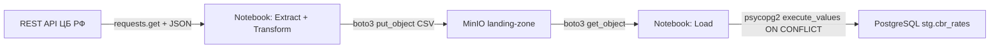

# HW1: REST API (ЦБ РФ) -> MinIO -> PostgreSQL

## Описание источника
**Источник:** Официальные курсы валют ЦБ РФ через стабильный REST API (`https://www.cbr-xml-daily.ru/daily_json.js`).

**Схема данных:**

| Поле | Тип | Описание |
|---|---|---|
| `record_date` | DATE | Дата установления курса (YYYY-MM-DD) |
| `currency_code` | VARCHAR(10) | Буквенный код валюты (например, USD, EUR) |
| `currency_name` | VARCHAR(100) | Наименование валюты |
| `nominal` | INT | Номинал (количество единиц валюты) |
| `value` | NUMERIC(10, 4) | Значение курса в рублях |

**Схема источника (фрагмент ответа API):**

```json
{
  "Date": "2026-11-21T13:00:00+03:00",
  "Valute": {
    "USD": {
      "ID": "R01235",
      "Code": "USD",
      "Nominal": 1,
      "Name": "Доллар США",
      "Value": 82.1911,
      "Previous": 82.1898
    }
  }
}
```

**Пример строки в целевой таблице:**

`2026-11-21 | USD | Доллар США | 1 | 82.1911`

**Объем:** ~34 записи (актуальные курсы всех публикуемых валют на дату запроса).

**Обоснование:** Курсы валют — эталонный справочный источник в финансовых DWH: он обновляется ежедневно, имеет стабильную схему и идеально подходит для демонстрации ежедневного инкрементального ingestion. Выбор реального REST API с финансовыми данными демонстрирует навыки работы с внешними сервисами и обработки JSON. Загрузка данных через MinIO landing zone повторяет реальный паттерн ELT: сырой snapshot в lake → нормализованная загрузка в warehouse.

---

## Схема целевой таблицы
Таблица `stg.cbr_rates` в PostgreSQL создается скриптом `init/init.sql`:

```sql
CREATE SCHEMA IF NOT EXISTS stg;

CREATE TABLE IF NOT EXISTS stg.cbr_rates (
    id SERIAL PRIMARY KEY,
    record_date DATE NOT NULL,
    currency_code VARCHAR(10) NOT NULL,
    currency_name VARCHAR(100) NOT NULL,
    nominal INT NOT NULL,
    value NUMERIC(10, 4) NOT NULL,
    loaded_at TIMESTAMP DEFAULT NOW(),
    UNIQUE (record_date, currency_code)
);

CREATE INDEX IF NOT EXISTS idx_cbr_rates_date ON stg.cbr_rates(record_date);
```

---

## Архитектура пайплайна



---

## Инструкция по запуску

1. **Инфраструктура:** Убедитесь, что Docker Desktop запущен. В корне репозитория выполните:

   ```bash
   docker compose up -d
   ```

   *(Проверка: `docker compose ps` должен показать статус `healthy` для `de_postgres` и `de_minio`)*.

2. **Конфигурация:** Убедитесь, что файл `.env` создан на основе `.env.example` и содержит корректные учетные данные (включая `MINIO_ENDPOINT=http://localhost:9000`).

3. **Зависимости:** Активируйте виртуальное окружение и установите пакеты:

   ```bash
   python -m venv .venv
   .venv\Scripts\activate          # Для Windows
   # source .venv/bin/activate     # Для macOS/Linux
   pip install -r requirements.txt
   ```

4. **Запуск ETL:** Откройте `notebooks/etl.ipynb` и выполните все ячейки сверху вниз (`Run -> Run All`).

5. **Проверка в БД:** Подключитесь через DBeaver или `psql` и выполните:

   ```sql
   SELECT COUNT(*) FROM stg.cbr_rates;
   SELECT * FROM stg.cbr_rates WHERE currency_code IN ('USD', 'EUR');
   ```

---

## Проверка идемпотентности
Пайплайн является идемпотентным. При повторном запуске ячейки **Load** (или всего ноутбука) количество строк в таблице не увеличивается, так как используется конструкция:

```sql
ON CONFLICT (record_date, currency_code) DO NOTHING
```

Это гарантирует отсутствие дубликатов при любых повторных выполнениях.

---

### Результат выполнения пайплайна
При успешном выполнении всех ячеек ноутбука, итоговая проверка выводит актуальные курсы из базы данных:

| record_date | currency_code | currency_name | value |
|---|---|---|---|
| 2026-11-24 | EUR | Евро | 90.2815 |
| 2026-11-24 | USD | Доллар США | 82.1488 |

*При повторном запуске количество строк не меняется благодаря `ON CONFLICT DO NOTHING`*

## Что можно улучшить (Next Steps)
- **Оркестрация:** Вынести скрипты в Airflow DAG. Добавить `HttpSensor` для проверки доступности API и `S3KeySensor` для ожидания файла в MinIO перед загрузкой в БД.
- **Логирование:** Заменить `print` на `structlog` или стандартный `logging` с выводом в JSON для последующей агрегации в ELK Stack.
- **Качество данных (Data Contracts):** Добавить валидацию схемы через `Pydantic` или `Great Expectations` перед записью в БД (например, проверка `value > 0`).
- **Типизация:** Перейти к строгой типизации кода с использованием `pyproject.toml` и `mypy`.
- **Потоковая ingestion:** Для real-time сценариев заменить пакетную выгрузку CSV на продюсирование событий в Kafka с последующей загрузкой через Kafka Connect.
